- [How to access the resources](#how-to-access-the-resources)
    - [Console](#console)
    - [Nautilius](#nautilus)
    - [Visual Studio Code](#visual-studio-code)
- [Folder structure](#folder-structure)
    - [/gpfs/home](#gpfshome)
    - [/gpfs/projects](#gpfsprojects)
    - [/gpfs/apps](#gpfsappsmn4)
    - [/gpfs/scratch](#gpfsscratch)
- [Version Control](#version-control)
- [How to upload data](#how-to-upload-data)
- [Data maintainment](#data-maintainment)
- [How to execute jobs](#how-to-execute-jobs)
    - [Interactively](#interactively)
    - [Batch Submitting](#batch-submitting)
    - [Rstudio in Nord4 server](#rstudio-in-nord4-server)


# How to access the resources

Cluster resources can be reached in different ways, but all require
having a valid username ID and a password to get access to them. The
connection will always be made through one of the available login nodes
n4login1, n4login2 and n4login3.

## **Console** :

Open a terminal in your PC and type:

```bash
ssh <user_name>@<login_node>.bsc.es
```

Replace **\<user\_name\>** with your nord4 ID and **\<login\_node\>** with either n4login1, n4login2 or n4login3. The prompt will ask you to type
in the password and you will see something like this:

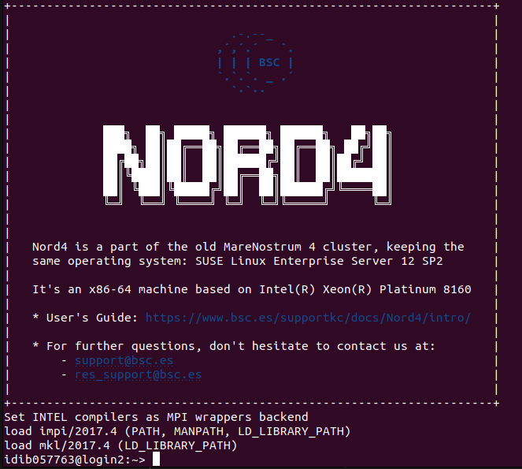

In this case we have logged in via n4login2. If we type pwd we will
see, we are inside our home (**/home/rcli/\<user\_name\>**) directory.
Using cd command you can move inside the system.

## **Nautilus**

On a Unix system, open a Nautilus window and search the **+ Other Locations** button on the left hand bar.


Click on it and you will see a bar on the right bottom of the page

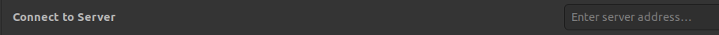

Type:

```bash
sftp://<user_name>@<login_node>.bsc.es/
```
and click **Connect**.

Your home (**/gpfs/home/\<institution\>/\<user\_name\>**) will open and then you can
navigate through all the directories.

## **Visual Studio Code**

In Visual Studio Code you can establish connection through ssh aswell.

Click the following icon on the bottom-left corner of the screen:

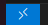

It will open the following dialogue box on top of the screen:

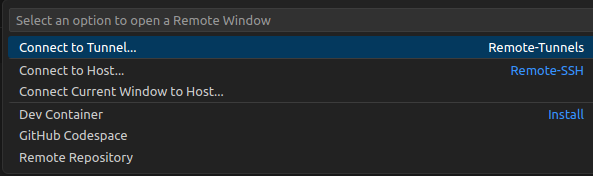

Here you can choose either **Connect to Host** or **Connect Current Window to Host**. Then clink on **+ Add New SSH Host**.

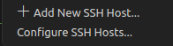


and type: 
    
```bash
ssh <user_name>@<login_node>.bsc.es
```

Now, instead of clicking  **+ Add New SSH Host** in the previous menu, we select **Configure SSH Hosts**. 
Then clik on **/home/user/.ssh/config**

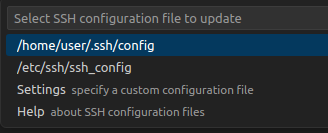

The config file will open for edit. By default, you will have a non-configured SSH Host:

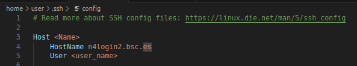

Replace **\<Name\>** with a nickname for your Host and **\<user\_name\>** with your nord4 ID and save the file. Now every time you want to establish a connection to the server with VSCode you can just click on the nickname given to your node of insterest with **Connect to Host** or **Connect Current Window to Host** options.

# Folder structure

Nord4 uses a General Parallel File System (GPFS), mounted at:

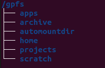


These directories are accessible from all Nord4 login nodes.

## **/gpfs/home**

```bash
/gpfs/home/<institution_id>/<user_name>/
```

-   It contains all the user's home directories within their corresponding institution folder.

-   This is the default directory you are directed to upon logging in via SSH.

-   Each user's home directory is personal and comes with a default quota of 10 GB, making it <span style="color:red">unsuitable for storing large datasets</span>.

-   It is intended for <span style="color:green">storing personal data and user-developed scripts</span>.

-   A backup is performed daily.

## **/gpfs/projects**

```bash
/gpfs/projects/<group_id>/
```

-   It contains all the group project directories.

-   Group project directories can be accessed only by its members.

-   Group projects are assigned dedicated job queues, and <span style="color:green">within this folder members should run their jobs or processes</span>.

-   The quota of these job queues can be consulted running **bsc\_quota** in the terminal.

-   It is <span style="color:red">not intended for long-term storage</span>. See data maintainment part.

-   **/gpfs/projects** is backed up periodically.

## **/gpfs/apps/MN4**

```bash
/gpfs/apps/MN4/<APP_NAME>/
```

-   It includes all the software, applications, and libraries available to users on Nord4—a system built upon MareNostrum 4 (MN4) infrastructure.

-   To use any of the available resources, you must load them—along with their dependencies—before running your jobs.

-   <span style="color:red">Users do not have permission to modify any content</span>. If you need a library or package that is not available, please contact **<support@bsc.es>** to request its installation. Before doing so, make sure the software is indeed not already installed.

-   Within this directory, you can find **/gpfs/apps/SL/BIODATA**, which is intended to store biological and clinical databases, such as reference genome or transcriptome versions for the most common model organisms. With this centralized storage of datasets, uploading these files to your group project directories is no longer necessary. Originally created for the StarLife (SL) cluster, it is now accessible to all Nord4 users.


### <span style="color:navy">EXAMPLE: Loading /gpfs/apps/MN4/R/4.3.0 </span>

```bash
module load gcc pcre2 R/4.3.0
```

If we access _gpfs/apps/MN4/R/_, we can see all **R** versions available. Each one with a designated folder:

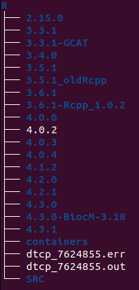

Each installation contains:

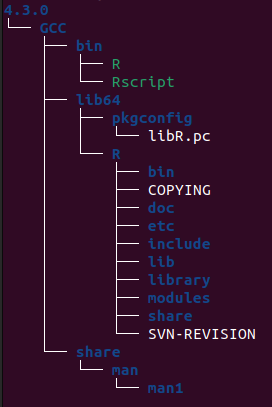

Within _/gpfs/apps/MN4/R/4.3.0/GCC/lib64/R/library/_, you can find all the packages installed for this version of **R**. Here's a quick glimpse:

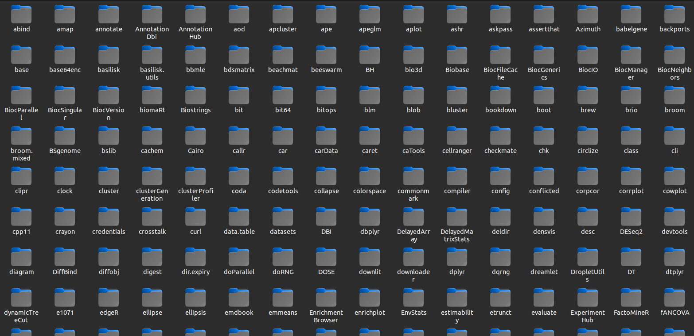


## **/gpfs/scratch**

```bash
/gpfs/scratch/<group_id>/MN4/<group_id>/<user_name>
```

-   It provides storage with a quota of up to 2.5TB, but typically offers several hundred GBs.

-   <span style="color:red">It is not backed up</span>. 

-   <span style="color:green">It is meant for temporary storage of files generated by job execution</span>. Since it is not maintained, users are responsible for freeing up space and keeping external backups if needed.


# Version Control

There\'s no outgoing internet connection from the cluster, which
prevents the use of external repositories directly from our machines. To circumvent that, you can use the sshfs command in your local machine.
Doing that, you can mount a desired directory from our GPFS system in
your local machine.

First, by mounting a desired remote directory onto a local directory of
your laptop, you can work locally on your existing code in the cluster
and making sure all the changes are replicated in the corresponding file within the GPFS system.

Second, you can track all the changes in your code by synchronizing your local working directory with a cloud repository (using git).

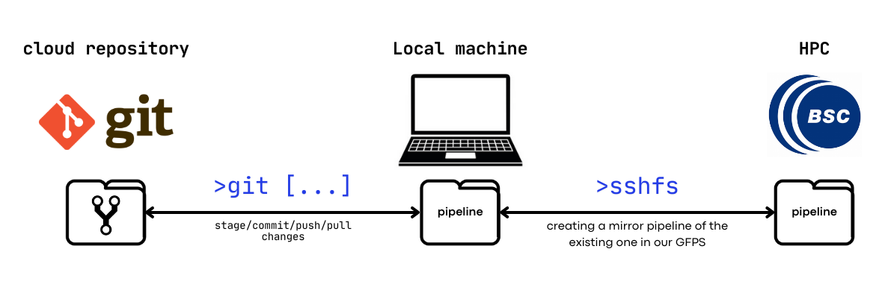

Steps:

-   Create an empty directory in your local machine that will be used as
    a mount point.

-   Run sshfs to mirror the directory of interest in the HPC with your
    newly created directory.

```bash
sshfs -o workaround=rename <username>@n<login_node>.bsc.es:/path/to/remote/directory /path/to/local/empty/directory
```

-   Clone an existing repository (GitHub,
    GitLab) into your local mounted directory. This will be immediately
    reflected in your remote directory.

-   Check that your repository is up to date, and which branch you are
    operating from by running **git status** from your working terminal.

# How to upload data

To copy files from/to the Cluster you can use direct scp, sftp or rsync with the aid of transfer nodes. 

## Using rsync

We recommend using rsync for uploading large datasets, as it supports resuming transfers in case of an unstable connection. Typical commands used through the transfer node include:

-   **From local machine to remote path** (execute in local):

    ```bash
    rsync -av --progress --partial --append local/path/files <user_name>@transfer1.bsc.es:/path/to/remote/directory
    ```

-   **From remote path to local** (execute in server):

    ```bash
    rsync -av --progress --partial --append <user_name>@transfer1.bsc.es:/path/to/remote/files /your/local/destination/
    ```

Recommended flags:
- **_-a_** | **_--archive_** : Combines several options to preserve the folder structure, including permissions, modification times, symbolic links, and ownership.
- **_-v_** | **_--verbose_** : Displays detailed output of the actions being performed in the terminal.
- **_--progress_** : Shows the progress of file transfers in real time.
- **_--partial_** : Allows interrupted transfers to be resumed without starting over.
- **_--checksum_** : Verifies file integrity at the destination by comparing checksums. Note: this option can significantly slow down the transfer.

# Data maintainment 

A typical workflow in an HPC environment for bioinformatics includes three main steps:

1. **Uploading raw data** to the server.
2. **Running the analysis** using available computational resources.
3. **Retrieving and downloading results** to a shared location accessible to project collaborators.

**But what happens when we start working on more projects?**\
The amount of data—ranging from a few gigabytes to several terabytes—can grow quickly in our HPC storage. That’s why it’s important to have a plan in place to manage data and storage space responsibly and securely.

As noted in the folder structure section, **none of the directories are intended for long-term data storage**. Therefore, once a project is completed, the **data should be moved to a more suitable long-term storage system**. Regular cleanup sessions should also be conducted to free up
space for active projects.

Once a project is completed, it is good practice to deposit raw data in
a public repository (e.g., EGA, ENA, GEO) to make it accessible to the
scientific community. Likewise, all code written during the analysis
should be pushed to a version-controlled repository (e.g., GitHub,
GitLab) to ensure reproducibility. Temporary and intermediate files
should be removed once the project has concluded.


## bsc_quota
Quota space on nord4 can be consulted via the command **bsc\_quota**.

In the following image are shown the different block spaces for group
idib57.

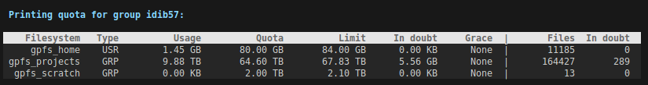

The different fields in the quota output are described below:

- **Type**: Whether personal (USR) or shared among group members (GRP).

-   **Usage**: The amount of disk space currently in use.

-   **Quota**: The soft limit of the fileset. Exceeding
    this limit by less than 5% will not immediately block writes, but if
    the limit remains exceeded beyond the grace period (typically 7
    days), the fileset will be blocked.

-   **Limit**: The hard limit of the fileset. Surpassing
    this limit will immediately block any further data writing.

-   **In doubt**: Disk usage that is not yet accounted
    for. This may result from ongoing operations, exceeded quotas, or
    write errors.

-   **Grace**: The time remaining before the fileset is
    blocked due to exceeding the soft limit. The default grace period is
    7 days.

-   **Files**: The total number of files within the
    fileset.

-   **In doubt** (Files): Same as above, but refers to
    unaccounted file counts rather than disk space.

# How to execute jobs

## **Interactive jobs**

Although interactive jobs can be run directly from any of the five login nodes (n4login1 to n4login5), only the first three (n4login1, n4login2, and n4login3) are intended for editing, compiling, and submitting batch jobs. On these nodes, interactive sessions are limited to 10 minutes.

You can switch between login nodes using commands like **ssh login4** after connecting to one of the other nodes.

## **Allocating jobs**

If your job needs more than 10 minutes to run it needs to be done through interactive allocation in the interactive partition or in a compute node (main partition).

-   In an interactive partition:

    ```bash
    salloc -p interactive -A <UNIXGROUP> -q <queue>.
    ```

-   In a compute node:

    ```bash
    salloc -n1 -c2 -A <UNIXGROUP> -q <queue> #Example to request 1 task and 2 CPUs per task.
    ```

If you are not sure about what queues are available you can run the
command **bsc\_queues**.

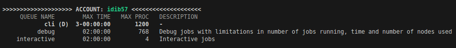

In the image above you can see there are 3 different queues available
for this user, their description and limitations.

If you start an interactive session in the interactive partition, you
will be re-directed to some of the interactive nodes (login1, login2,...
login5). Whereas in the main partition you will be re-directed to a
compute node.

In the following example we started two interactive jobs:

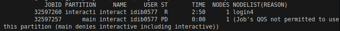

The one with the JOBID 32597260 is running in the interactive partition
and node login4 was allocated. The job with JOBID 32597257 has been
launched in the main partition, but the user tried to allocate the job
in the interactive queue and therefore no node has been allocated since
this relation is not allowed.

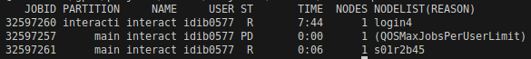

To run interactive sessions in the main partition the queue parameter has to be set to cli or debug like in the job 32597261. Notice it is already
running while 32597257 is still in pending (PD) state (ST).

Once you want to finish the interactive session just type **exit**.

## **Batch Submitting:**

Nord4 cluster uses Slurm (Simple Linux Utility for Resource Management)
as its job scheduler. Slurm organizes and allocates computing resources
in HPC clusters, ensuring fair and efficient usage.

-   Manages resources (nodes, tasks, CPUs, memory, time, etc.) across a
    computing cluster.

-   Schedules user-submitted jobs, determining when, where, and how they
    run based on available resources and priorities.

-   Handles job queues, prioritization, dependencies, and job arrays.

-   Enables efficient sharing of compute resources among multiple users
    and workloads.

A job is the basic unit of execution in Slurm. It is defined by a job script (a text file containing a set of Slurm directives and shell commands). The directives specify the job's resource requirements and are written as special comments in the script. These must follow a specific syntax to correctly inform the system of the job\'s needs.

Jobs are submitted using the sbatch command-line tool. Sbatch does:

-   Accepts a job script containing Slurm directives and shell commands.

-   Submits the script to Slurm, which queues and schedules it for execution on available compute nodes.

-   Returns a job ID, which can be used to monitor or manage the job.

The basic sbatch syntax is:

```bash
    #SBATCH --directive=<value>
```

In most bioinformatic processes a single node will be enough for jobs to run. So, we recommend always setting \#SBATCH \--node=1 and only modify two main directives: cpus-per-task and time.

```bash
   #SBATCH --cpus-per-task=<value>

   #SBATCH --time=<hh:mm:ss>
```

A regular sbatch script would have the following pattern:

```bash
#!/bin/bash

#SBATCH --job-name=<job_name>           # Job name

#SBATCH --output=<job_name>.out         # Output file

#SBATCH --error=<job_name>.err          # Error file

#SBATCH --nodes=1                       # Number of nodes

#SBATCH --cpus-per-task=<value>         # Number of CPUs per task

#SBATCH --time=<hh:mm:ss>               # Time limit

#SBATCH --account=<UNIX_GROUP>          # UNIX GROUP

#SBATCH --qos=<queue>                   # queue where to run the job

module load <necessary modules>

<rest of the code>
```

Bear in mind that in Nord4 each CPU has approximately 2GB of RAM so
necessary CPUs can be calculated as (GB needed)/2.

As an example, here's a sbatch script to call an Rscript called
my\_r\_script.R to run in a single Nord4 node with approximately 8GB of
RAM for 1.5 hours as maximum:

```bash
#!/bin/bash

#SBATCH --job-name=R_job            # Job name

#SBATCH --output=R_job.out          # Output file

#SBATCH --error=R_job.err           # Error file

#SBATCH --nodes=1                   # Number of nodes

#SBATCH --cpus-per-task=4           # Number of CPUs per task

#SBATCH --time=01:30:00             # Time limit (hh:mm:ss)

#SBATCH --account=idib57            # UNIX GROUP

#SBATCH --qos=cli                   # queue where job will run

module load gcc pcre2 R/4.3.0       # Load R module and dependencies.

Rscript path/to/my_R_script.R       # Execute the Rscript.
```

This sbatch script can be either saved as a .sh or .sbatch (for example:
R_job.sbatch) and the correct form to run it is:

```bash
sbatch R_job.sbatch
```

To see the status of the job just type **squeue** and it will appear
together with the JOBID. To cancel a job, whether it is running or not,
just type **scancel \<JOBID\>**.

Nord4 has 72 nodes with 96GB/node but if your job requires more RAM
there is the possibility to specify a high memory node (384GB/node i.e.
8GB per core). Add the following in the \#SBATCH directives:

```bash
#SBATCH --constraint=highmem
```

Requesting these nodes will make the job last longer in the queue before start running.

## Rstudio in Nord4 server

### **Private connection to compute node**

Create and save the following script as a bash (.sh extension) script.
For example: Rstudio\_server.sh.

```bash
#!/bin/bash

#SBATCH --job-name=rstudio_server

#SBATCH --output=rstudio_%j.out

#SBATCH --error=rstudio_%j.err

#SBATCH --nodes=1

#SBATCH --ntasks=1

#SBATCH --cpus-per-task=48

#SBATCH --account=idib57

#SBATCH --time=01:00:00

#SBATCH --exclusive

#SBATCH --qos=cli


# Load all required modules for you application here:

module load gcc/7.2.0 pcre2/10.39 boost/1.69.0 R/4.1.2 openssl/1.1.1o
RSTUDIO/1.3-rserver

# For RStudio server (default port: 8787)

rserver --www-address=127.0.0.1
```

Once you have it ready, open a terminal and run the script doing:

```bash
sbatch path/to/Rstudio_server.sh
```

This script is thought to reserve a whole compute node for your user.
Run **squeue** to see when it starts running and which node is reserved for
you.

```bash
squeue
```

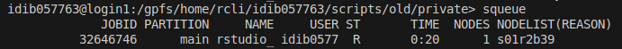

In the case above we got s01r2b39 reserved for us.

To complete the compute node reservation now we have to generate a unix
socket. This socket has to be private for us so a good practice would be
to first change to a private directory, for example, our **/gpfs/home/\<institution\>/\<user_name\>**.
Then, run the following command with the compute node reserved:

```bash
ssh -L ./socket.sock:localhost:8787 <node_ID> # change the compute node
```

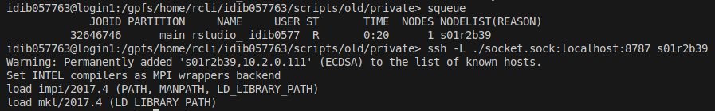

Now a new file named socket.sock has been created in your private home
directory. If it's not the first time you do this remember to first
delete the socket.sock doing **rm socket.sock** prior to create it
again.

### **Connection from local PC to login node**

First open a new terminal. It won't work in the same terminal above.
Don't connect into the cluster! You want to establish this connection
from your local machine to the socket.

Run the following command changing with your actual Starlife ID.

```bash
ssh -L 8787:/path/to/private/directory/socket.sock <user_name>@<login_node>.bsc.es # change Starlife ID
```

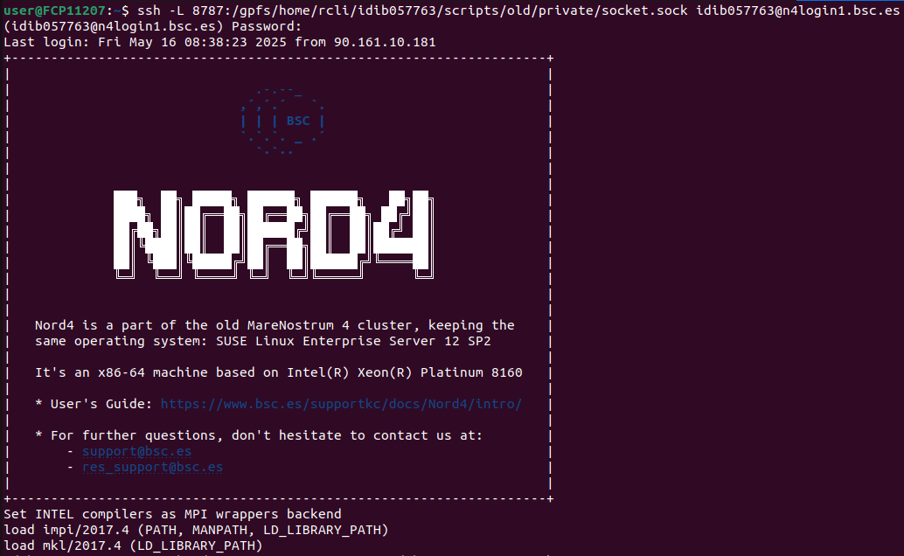

Now the port has been created. Open a web browser (Firefox or Chrome,
for example) and type:

**http://localhost:8787**

A new Rstudio session will prompt inside the cluster directories.

Bear in mind that both connections have to be established with the same login node. In the case above we launched the script when logged with n4login1. Then we had to establish the connection from our local machine to the socket with the same node. Otherwise, it wouldn't have worked.